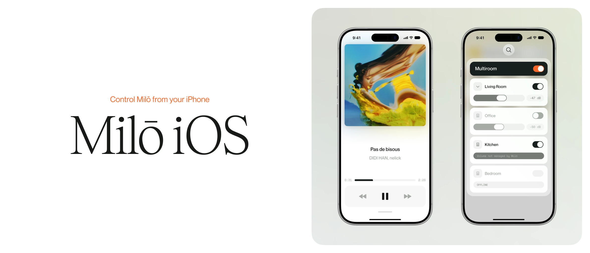

  

# Milō iOS

Control Milō from your iPhone.

Milō iOS is the iPhone companion for [Milō](https://github.com/leodurandfr/Milo), the
Raspberry Pi music system. It opens Milō's interface full screen as an app, adds a volume
widget to the Home Screen, and shows what Milō plays on the lock screen.

## Requirements

- iOS 26 or later. The lock-screen player needs iOS 27.
- A Milō on the same Wi-Fi network as the iPhone. The app finds it at `milo.local`: there is
  nothing to set up.

## What it does

- **Milō's interface as an app**: every source, multiroom, the equalizer and the settings,
  full screen and without the browser's bars. It reconnects by itself when Milō restarts or
  the phone comes back on the network.
- **A Home Screen widget**: two buttons to turn Milō's volume down or up. The level shows for
  a few seconds after a press, and the Milō logo dims while Milō cannot be reached.
- **The lock screen, Control Center and the Dynamic Island** (iOS 27): the track, its cover
  and its progress, the buttons the current source accepts, and Milō's volume. The volume
  buttons on the side of the iPhone move Milō's volume one step at a time. Commands go
  straight to Milō over the local network.

## Install

Milō iOS is not on the App Store. It installs from Xcode, on an iPhone you own.

1. Open `Milo-iOS.xcodeproj` in Xcode 27 or later (the lock-screen extension is built against
   the iOS 27 SDK).
2. Select your Apple team under *Signing & Capabilities* for the three targets: `Milo-iOS`,
   `MiloWidgetExtension` and `MiloNowPlayingExtension`. With a team other than the original
   one, change the bundle identifiers and the App Group (`group.leodurand.Milo-iOS`) to ones
   your team owns.
3. Run the `Milo-iOS` scheme on your iPhone.

## Push from Milō

Milō itself tells the iPhone when something changes, through Apple's push service: that is
how the lock-screen player opens while the app is closed, and how the widget stays current.
Milō needs a push signing key for this, `AuthKey_<KEYID>.p8` from your Apple developer
account, placed in `/var/lib/milo/apns/` on the Milō (owner `milo`, mode `0600`). Milō sends
pushes for the team and app named by `APNS_TEAM_ID` and `IOS_APP_BUNDLE_ID` in its
[`backend/config/constants.py`](https://github.com/leodurandfr/Milo/blob/main/backend/config/constants.py),
so a build under another team changes them there too.

Without a key, Milō works as usual and sends nothing: the lock-screen player then shows only
while the app is open, and the widget refreshes on iOS's own schedule.
